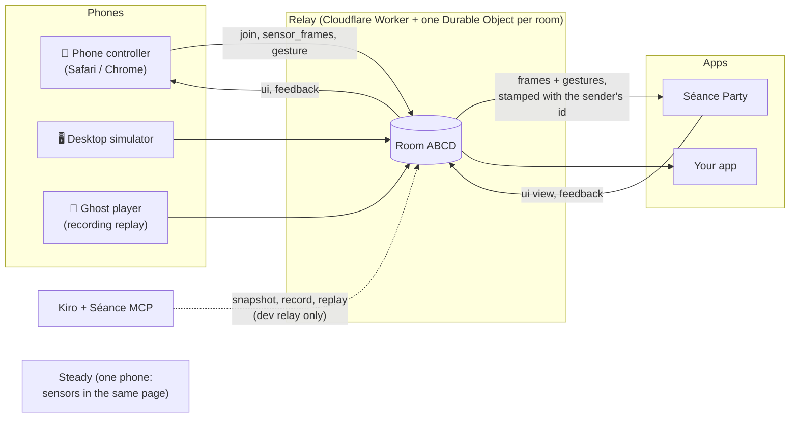

# Haunt Kit 👻

**Turn any phone into a motion, sound and touch controller for a web app.** Scan a QR code, tap once, and your phone's tilt, shakes, mic loudness and taps reach the app. Nothing to install.

Built with [Kiro](https://kiro.dev) for the Kiroween 2026 hackathon, **Skeleton Crew** category: one reusable kit, two different apps.

| App              | What it is                                                                                                                                                                                          | Folder                                   |
| ---------------- | --------------------------------------------------------------------------------------------------------------------------------------------------------------------------------------------------- | ---------------------------------------- |
| **Séance Party** | A Halloween party game for 1 to 8 players on a big screen. Tilt together to steer a Ouija planchette, hold still so the ghost doesn't see you, out-scream the banshee. AI ghost bots for solo play. | [`apps/seance-party`](apps/seance-party) |
| **Steady**       | A home physical-therapy rep counter on one phone. Counts reps out loud, measures range of motion and makes a report for your therapist. Your data stays on your phone. Not a medical device.        | [`apps/steady`](apps/steady)             |

## Try it in 10 seconds

| What             | Link                                                                                   |
| ---------------- | -------------------------------------------------------------------------------------- |
| Séance Party     | https://haunt-kit-seance.pages.dev                                                     |
| Steady           | https://haunt-kit-steady.pages.dev                                                     |
| Phone controller | https://haunt-kit-play.pages.dev (the QR code in Séance Party opens it)                |
| Relay            | `wss://haunt-kit-relay.yadnesh-deshpande2-1.workers.dev` (health check: add `/health`) |
| No phone?        | In Séance Party click **Join from this computer**, or in Steady click **Try the demo** |

Judges: see **[docs/JUDGE_TESTING.md](docs/JUDGE_TESTING.md)** for testing alone, with one phone, or with no phone.

## How it works



- The phone reads motion at 30 Hz. In tilt and scream views it streams samples in batches every 100 ms. In other views it runs gesture detectors **on the phone** and sends only events.
- Mic loudness is computed on the phone. **Audio never leaves the phone**, only a number from 0 to 1.
- Every message is checked with zod (`packages/protocol`). A phone can't send input as another player.
- If an iPhone locks its screen, the player rejoins with the same slot and color within 60 s. If the host drops, the room waits 2 minutes.

## Packages

| Package                 | What it does                                                                |
| ----------------------- | --------------------------------------------------------------------------- |
| `@haunt-kit/protocol`   | Message types and zod schemas, room codes                                   |
| `@haunt-kit/relay`      | Room logic, Cloudflare Worker + Durable Object, Node relay, in-memory relay |
| `@haunt-kit/controller` | Phone controller page and the desktop simulator (`sim.html`)                |
| `@haunt-kit/host-sdk`   | `createRoom`, `createMockRoom`, `createLocalSession`, ghost players         |
| `@haunt-kit/gestures`   | Gesture detectors and Ghost Recordings                                      |
| `@haunt-kit/ui`         | Design system (haunted and lantern themes)                                  |
| `@haunt-kit/mcp-server` | Séance MCP: lets Kiro read live phone sensors and replay recordings         |

## Add phone controls to your app

```ts
import { createRoom, createMockRoom, createLocalSession } from "@haunt-kit/host-sdk";

const room = await createRoom({ relayUrl: "wss://<relay>", controllerUrl: "https://<controller>/" });
// No relay and no phones, with fake players:
// const room = await createMockRoom({ ghosts: [{ name: "Casper" }, { name: "Boo", recording: "shake" }] });
// One phone that is also the screen (like Steady):
// const room = createLocalSession(); button.onclick = () => room.start();

document.body.insertAdjacentHTML("beforeend", room.qrSvg); // QR code for room.joinUrl
room.on("player_joined", (p) => room.setUi(p.playerId, { view: "tilt", title: "Steer the planchette" }));
room.on("frames", ({ playerId, samples }) => {
  /* { t, ax, ay, az, gx, gy, gz, alpha, beta, gamma, rms? } */
});
room.on("gesture", ({ playerId, event }) => {
  /* { name: "shake", t, data? } */
});
room.sendFeedback("all", { kind: "flash", color: "#ff79c6" });
```

Control views a phone can show: `tilt`, `still`, `scream`, `tap`, `wait`.

## Developer quickstart

Requirements: Node 22 and pnpm (`corepack enable`).

```bash
git clone https://github.com/Kiroween2026/haunt-kit.git
cd haunt-kit
pnpm install
pnpm test
```

### Try it on your phone

Motion sensors need HTTPS, so the phone goes through one `cloudflared` tunnel. The controller's dev server proxies `/relay` to the local relay, so one tunnel covers both.

```bash
pnpm dev:relay        # relay on ws://127.0.0.1:8787
pnpm dev:controller   # phone page on http://localhost:5180 (simulator: /sim.html)
pnpm dev:demo         # dot demo on http://localhost:5181
pnpm dev:seance       # Séance Party on http://localhost:5183 (works with no relay: practice mode)
pnpm dev:steady       # Steady on http://localhost:5184
cloudflared tunnel --url http://localhost:5180
```

Open `http://localhost:5181/?play=https://<your-tunnel>.trycloudflare.com` on the laptop, scan the QR code, tap **Enter the séance** and tilt. No phone? Click **Add ghost player**, or open `http://localhost:5180/sim.html`.

### Séance MCP (Kiro sees your phone)

```bash
pnpm dev:token   # once: writes HAUNT_DEV_TOKEN to .env.local (git-ignored)
pnpm dev:relay
```

Enable the `seance` server in Kiro's MCP panel. Kiro can list phones, read live sensor stats, record motions into `recordings/`, and replay them as fake players. Rules: `.kiro/steering/mcp-usage.md`.

### Scripts

| Script                                                     | What it does                                        |
| ---------------------------------------------------------- | --------------------------------------------------- |
| `pnpm test`                                                | Unit and property-based tests (Vitest + fast-check) |
| `pnpm e2e`                                                 | Playwright end-to-end tests on WebKit and Chromium  |
| `pnpm lint` / `pnpm typecheck`                             | ESLint / TypeScript in every package                |
| `pnpm format` / `pnpm format:check`                        | Prettier                                            |
| `pnpm build`                                               | Build both apps and the controller                  |
| `pnpm dev:seance` / `pnpm dev:steady`                      | Run an app                                          |
| `pnpm dev:relay` / `pnpm dev:controller` / `pnpm dev:demo` | Local relay, phone controller, dot demo             |
| `pnpm dev:token`                                           | Create a dev token for the Séance MCP               |

## Supported devices

| Device          | Status                                                                                                                                                                  |
| --------------- | ----------------------------------------------------------------------------------------------------------------------------------------------------------------------- |
| iPhone, Safari  | Main target. One tap asks for motion and mic. Screen kept awake; rejoin after lock. No vibration on iPhone, so feedback is flash, color and sound.                      |
| Android, Chrome | Tested in automation (Chromium) and with the Android emulator's virtual sensors; one real device check planned. See [docs/ANDROID_TESTING.md](docs/ANDROID_TESTING.md). |
| Laptop          | Desktop simulator: mouse = tilt, keys = gestures, laptop mic = scream.                                                                                                  |

## Built with Kiro

Specs in `.kiro/specs/`, steering in `.kiro/steering/`, the Séance MCP in `.kiro/settings/mcp.json`, and a log of real events in [KIRO_LOG.md](KIRO_LOG.md). Writeup: [docs/KIRO_WRITEUP.md](docs/KIRO_WRITEUP.md).

## More docs

[Deploying](docs/DEPLOY.md) · [Security](docs/SECURITY.md) · [Android testing](docs/ANDROID_TESTING.md) · [Contributing](CONTRIBUTING.md)

## License

[MIT](LICENSE)
